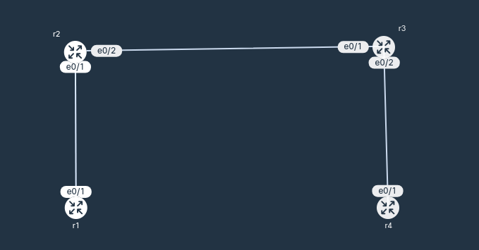

# 003-iBGP-nexthopself
  BGP configuration and iBGP next-hop-self practice lab.
  
## Scenario

```
1. Configure eBGP between AS 100 and AS 200, AS 200 and AS 300. 
2. r1 (AS 100) learn r4 (AS 300) loopback ip, r4 also learn r1 loopback ip.
3. Verify: r1 (1.1.1.1) ping r4 (4.4.4.4) successfully.
Note: iBGP routing need manual next-hop-self.

AS 100:
  r1: e0/1, 10.0.12.1/30
      lo0, 1.1.1.1/32
AS 200:
  r2: e0/1, 10.0.12.2/30
      e0/2, 10.0.23.1/30
      lo0, 2.2.2.2/32
  r3: e0/1, 10.0.23.2/30
      e0/2, 10.0.34.1/30
      lo0, 3.3.3.3/32
AS 300:
  r4: e0/1, 10.0.34.2/30
      lo0, 4.4.4.4/32
```

## Action
1. Reachability: directly connected (no need iGP)
2. Neighbor forming: `router bgp as-number` `neighbor [their-ip] remote-as [their-as]`
```
  - r1: `router bgp 100` `neighbor 10.0.12.2 remote-as 200`
  - r2: `router bgp 200` `neighbor 10.0.12.1 remote-as 100` 
        `neighbor 10.0.23.2 remote-as 200` `neighbor 10.0.23.2 next-hop-self`
  - r3: `router bgp 200` `neighbor 10.0.23.1 remote-as 200` `neighbor 10.0.23.1 next-hop-self`
        `neighbor 10.0.34.2 remote-as 300` 
  - r4: `router bgp 300` `neighbor 10.0.34.1 remote-as 200`
  
```
3. Network advertisement:
```
  - r1: `router bgp 100` `network 1.1.1.1 mask 255.255.255.255`
  - r4: `router bgp 300` `network 4.4.4.4 mask 255.255.255.255`
```
## Result
1. BGP routes advertisement happen from the other end, while static routing happen from here to there.
2. eBGP automatically specify own ip as next hop when advertise a network.
3. iBGP edge router must manually specify next-hop-self to other iBGP router.
4. r1 ping r4 by `ping 4.4.4.4 source 1.1.1.1`, without specify source, r1 pick its interface ip
and current lab scope only advertise loopback ip.
5. LAB:
- ping:
```
r1#ping 4.4.4.4
Type escape sequence to abort.
Sending 5, 100-byte ICMP Echos to 4.4.4.4, timeout is 2 seconds:
.....
Success rate is 0 percent (0/5)
r1#ping 4.4.4.4 source 1.1.1.1
Type escape sequence to abort.
Sending 5, 100-byte ICMP Echos to 4.4.4.4, timeout is 2 seconds:
Packet sent with a source address of 1.1.1.1
!!!!!
Success rate is 100 percent (5/5), round-trip min/avg/max = 1/1/1 ms
```
- show ip bgp:
```
r1#show ip bgp
BGP table version is 3, local router ID is 1.1.1.1
Status codes: s suppressed, d damped, h history, * valid, > best, i - internal,
              r RIB-failure, S Stale, m multipath, b backup-path, f RT-Filter,
              x best-external, a additional-path, c RIB-compressed,
              t secondary path, L long-lived-stale,
Origin codes: i - IGP, e - EGP, ? - incomplete
RPKI validation codes: V valid, I invalid, N Not found

     Network          Next Hop            Metric LocPrf Weight Path
 *>   1.1.1.1/32       0.0.0.0                  0         32768 i
 *>   4.4.4.4/32       10.0.12.2                              0 200 300 i
```
```
r2#show ip bgp
BGP table version is 3, local router ID is 2.2.2.2
Status codes: s suppressed, d damped, h history, * valid, > best, i - internal,
              r RIB-failure, S Stale, m multipath, b backup-path, f RT-Filter,
              x best-external, a additional-path, c RIB-compressed,
              t secondary path, L long-lived-stale,
Origin codes: i - IGP, e - EGP, ? - incomplete
RPKI validation codes: V valid, I invalid, N Not found

     Network          Next Hop            Metric LocPrf Weight Path
 *>   1.1.1.1/32       10.0.12.1                0             0 100 i
 *>i  4.4.4.4/32       10.0.23.2                0    100      0 300 i
```
```
r3#show ip bgp
BGP table version is 3, local router ID is 3.3.3.3
Status codes: s suppressed, d damped, h history, * valid, > best, i - internal,
              r RIB-failure, S Stale, m multipath, b backup-path, f RT-Filter,
              x best-external, a additional-path, c RIB-compressed,
              t secondary path, L long-lived-stale,
Origin codes: i - IGP, e - EGP, ? - incomplete
RPKI validation codes: V valid, I invalid, N Not found

     Network          Next Hop            Metric LocPrf Weight Path
 *>i  1.1.1.1/32       10.0.23.1                0    100      0 100 i
 *>   4.4.4.4/32       10.0.34.2                0             0 300 i
```

```
r4#show ip bgp
BGP table version is 3, local router ID is 4.4.4.4
Status codes: s suppressed, d damped, h history, * valid, > best, i - internal,
              r RIB-failure, S Stale, m multipath, b backup-path, f RT-Filter,
              x best-external, a additional-path, c RIB-compressed,
              t secondary path, L long-lived-stale,
Origin codes: i - IGP, e - EGP, ? - incomplete
RPKI validation codes: V valid, I invalid, N Not found

     Network          Next Hop            Metric LocPrf Weight Path
 *>   1.1.1.1/32       10.0.34.1                              0 200 100 i
 *>   4.4.4.4/32       0.0.0.0                  0         32768 i
```
- show ip route:
```
r1#show ip route
Gateway of last resort is not set
      1.0.0.0/32 is subnetted, 1 subnets
C        1.1.1.1 is directly connected, Loopback0
      4.0.0.0/32 is subnetted, 1 subnets
B        4.4.4.4 [20/0] via 10.0.12.2, 00:31:00
      10.0.0.0/8 is variably subnetted, 2 subnets, 2 masks
C        10.0.12.0/30 is directly connected, Ethernet0/1
L        10.0.12.1/32 is directly connected, Ethernet0/1
```
```
r2#show ip route
Gateway of last resort is not set
      1.0.0.0/32 is subnetted, 1 subnets
B        1.1.1.1 [20/0] via 10.0.12.1, 00:41:27
      2.0.0.0/32 is subnetted, 1 subnets
C        2.2.2.2 is directly connected, Loopback0
      4.0.0.0/32 is subnetted, 1 subnets
B        4.4.4.4 [200/0] via 10.0.23.2, 00:32:06
      10.0.0.0/8 is variably subnetted, 4 subnets, 2 masks
C        10.0.12.0/30 is directly connected, Ethernet0/1
L        10.0.12.2/32 is directly connected, Ethernet0/1
C        10.0.23.0/30 is directly connected, Ethernet0/2
L        10.0.23.1/32 is directly connected, Ethernet0/2
```
```
r3#show ip route
Gateway of last resort is not set
      1.0.0.0/32 is subnetted, 1 subnets
B        1.1.1.1 [200/0] via 10.0.23.1, 00:43:38
      3.0.0.0/32 is subnetted, 1 subnets
C        3.3.3.3 is directly connected, Loopback0
      4.0.0.0/32 is subnetted, 1 subnets
B        4.4.4.4 [20/0] via 10.0.34.2, 00:43:37
      10.0.0.0/8 is variably subnetted, 4 subnets, 2 masks
C        10.0.23.0/30 is directly connected, Ethernet0/1
L        10.0.23.2/32 is directly connected, Ethernet0/1
C        10.0.34.0/30 is directly connected, Ethernet0/2
L        10.0.34.1/32 is directly connected, Ethernet0/2
```
```
r4#show ip route
Gateway of last resort is not set
      1.0.0.0/32 is subnetted, 1 subnets
B        1.1.1.1 [20/0] via 10.0.34.1, 00:44:10
      4.0.0.0/32 is subnetted, 1 subnets
C        4.4.4.4 is directly connected, Loopback0
      10.0.0.0/8 is variably subnetted, 2 subnets, 2 masks
C        10.0.34.0/30 is directly connected, Ethernet0/1
L        10.0.34.2/32 is directly connected, Ethernet0/1
```
