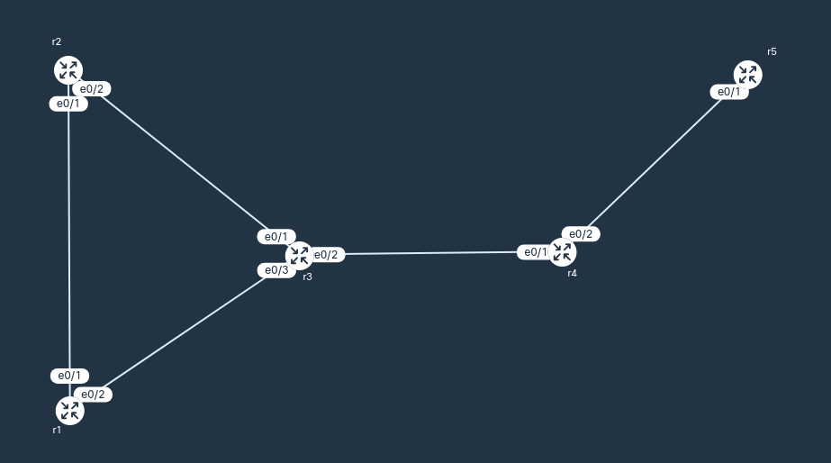

# 004-BGP-summaryroute
  BGP configuration and iBGP summaryroute (need static route Null0)
  
## Scenario

```
1. Configure eBGP between AS 200 and AS 300, AS 300 and AS 400. 
2. BGP: AS 200 advertise r1 loopback ip, and all internal ips, AS 400 advertise r5 loopback ip.
3. Verify: r1 (1.1.1.1) ping r5 (5.5.5.5) successfully both source 1.1.1.1 or no specify source

AS 200:
  r1: e0/1, 10.0.12.1/30
      e0/2, 10.0.13.1/30
      lo0, 1.1.1.1/32
  r2: e0/1, 10.0.12.2/30
      e0/2, 10.0.23.1/30
      lo0, 2.2.2.2/32
  r3: e0/1, 10.0.23.2/30
      e0/2, 10.0.34.1/30
      e0/3, 10.0.13.2/30
      lo0, 3.3.3.3/32
AS 300:
  r4: e0/1, 10.0.34.2/30
      e0/2, 10.0.45.1/30
      lo0, 4.4.4.4/32
AS 400:
  r5: e0/1, 10.0.45.2/30
      lo0, 5.5.5.5/32
```

## Action
1. Reachability: 
    - eBGP directly connected (no need iGP)
    - iBGP (AS 200) configure ospf (iGP) `router ospf 1` `network 10.0.0.0 0.0.255.255 area 0`
2. Neighbor forming: `router bgp as-number` `neighbor [their-ip] remote-as [their-as]`
```
  - r1: `router bgp 200` `neighbor 10.0.12.2 remote-as 200` `neighbor 10.0.13.2 remote-as 200`
  - r2: `router bgp 200` `neighbor 10.0.12.1 remote-as 100` `neighbor 10.0.23.2 remote-as 200`
  - r3: `router bgp 200` `neighbor 10.0.23.1 remote-as 200` `neighbor 10.0.13.1 remote-as 200`
        `neighbor 10.0.23.1 next-hop-self` `neighbor 10.0.13.2 next-hop-self`
        `neighbor 10.0.34.2 remote-as 300` 
  - r4: `router bgp 300` `neighbor 10.0.34.1 remote-as 200` `neighbor 10.0.45.2 remote-as 400`
  - r5: `router bgp 400` `neighbor 10.0.45.1 remote-as 300` 
```
3. Network advertisement:
```
  - r1: `router bgp 200` `network 1.1.1.1 mask 255.255.255.255`
  - r4: `router bgp 300` `network 4.4.4.4 mask 255.255.255.255`
  - r5: `router bgp 400` `network 5.5.5.5 mask 255.255.255.255`

  - r3: `router bgp 200` `network 10.0.0.0 mask 255.255.0.0`
        `ip route 10.0.0.0 255.255.0.0 Null0`
```
## Result & Notes
1. BGP only advertise routes exist on routing table. 
  - r2: `network 10.0.0.0 mask 255.255.0.0` not advertised until all these routes exist in routing table (our table only has few in this range).
  - fix: `ip route 10.0.0.0 255.255.0.0 Null0` static route Null0 enable all these routes in routing table.
2. r1 ping r5 by `ping 5.5.5.5`, without specify source, r1 pick its interface ip 10.0.13.1 as source ip.
r5 know 10.0.13.1 (advertised by r2), ping works.
3. LAB:
- ping:
```
r1#ping 5.5.5.5
Type escape sequence to abort.
Sending 5, 100-byte ICMP Echos to 5.5.5.5, timeout is 2 seconds:
!!!!!
Success rate is 100 percent (5/5), round-trip min/avg/max = 1/1/1 ms
r1#ping 5.5.5.5 source 1.1.1.1
Type escape sequence to abort.
Sending 5, 100-byte ICMP Echos to 5.5.5.5, timeout is 2 seconds:
Packet sent with a source address of 1.1.1.1
!!!!!
Success rate is 100 percent (5/5), round-trip min/avg/max = 1/1/1 ms
```
- show ip ospf neighbor:
```
r2#show ip ospf neighbor

Neighbor ID     Pri   State           Dead Time   Address         Interface
3.3.3.3           1   FULL/DR         00:00:35    10.0.23.2       Ethernet0/2
1.1.1.1           1   FULL/BDR        00:00:36    10.0.12.1       Ethernet0/1
```
- show ip bgp:
```
r1#show ip bgp
BGP table version is 5, local router ID is 1.1.1.1
Status codes: s suppressed, d damped, h history, * valid, > best, i - internal,
              r RIB-failure, S Stale, m multipath, b backup-path, f RT-Filter,
              x best-external, a additional-path, c RIB-compressed,
              t secondary path, L long-lived-stale,
Origin codes: i - IGP, e - EGP, ? - incomplete
RPKI validation codes: V valid, I invalid, N Not found
     Network          Next Hop            Metric LocPrf Weight Path
 *>   1.1.1.1/32       0.0.0.0                  0         32768 i
 *>i  4.4.4.4/32       10.0.13.2                0    100      0 300 i
 *>i  5.5.5.5/32       10.0.13.2                0    100      0 300 400 i
 *>i  10.0.0.0/16      10.0.13.2                0    100      0 i
```
- show ip route:
```
r3#show ip route
Gateway of last resort is not set

      1.0.0.0/32 is subnetted, 1 subnets
B        1.1.1.1 [200/0] via 10.0.13.1, 01:22:40
      3.0.0.0/32 is subnetted, 1 subnets
C        3.3.3.3 is directly connected, Loopback0
      4.0.0.0/32 is subnetted, 1 subnets
B        4.4.4.4 [20/0] via 10.0.34.2, 01:22:29
      5.0.0.0/32 is subnetted, 1 subnets
B        5.5.5.5 [20/0] via 10.0.34.2, 01:22:29
      10.0.0.0/8 is variably subnetted, 8 subnets, 3 masks
S        10.0.0.0/16 is directly connected, Null0 ############################### 
O        10.0.12.0/30 [110/20] via 10.0.23.1, 01:23:06, Ethernet0/1
                      [110/20] via 10.0.13.1, 00:05:36, Ethernet0/3
C        10.0.13.0/30 is directly connected, Ethernet0/3
L        10.0.13.2/32 is directly connected, Ethernet0/3
C        10.0.23.0/30 is directly connected, Ethernet0/1
L        10.0.23.2/32 is directly connected, Ethernet0/1
C        10.0.34.0/30 is directly connected, Ethernet0/2
L        10.0.34.1/32 is directly connected, Ethernet0/2
```
