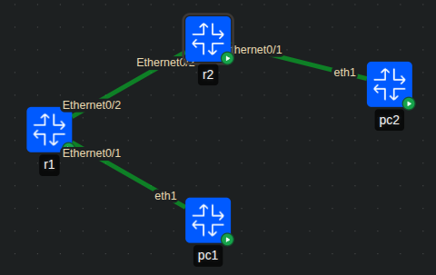

# Netmiko automation on Containerlab

Testing an automation script using Netmiko on Containerlab.

## Scenario



## Action

### 1. Project folder and YAML file

```bash
mkdir -p simple_script
cd simple_script
touch simple.clab.yml
```

[YAML file](simple.clab.yml) sample:

```yaml
name: simple

topology:
  nodes:
    r1:
      kind: cisco_iol
      image: vrnetlab/cisco_iol:17.18.2
    r2:
      kind: cisco_iol
      image: vrnetlab/cisco_iol:17.18.2
      # type: l2   (only for an L2 device)
  links:
    - endpoints: ["r1:Ethernet0/1", "r2:Ethernet0/1"]
```

### 2. Python script

[Python script](bgp_script.py) structure:

```python
import time
from netmiko import ConnectHandler

routers = {
    "router-ip": ["configuration", "commands"],
}

for ip, cmds in routers.items():
    # login, send config, print output
    ...
```

### 3. Deploy and tear down

Deploy:

```bash
containerlab deploy -t simple.clab.yml
```

Run the script:

```bash
source ~/dir/to/venv/bin/activate
python3 bgp_script.py
```

SSH to a router:

```bash
ssh admin@ipaddress
# or
ssh admin@clab-simple-r1
```

Tear down:

```bash
containerlab destroy -t simple.clab.yml --cleanup
```

## Result

1. Containerlab uses YAML to deploy and destroy the topology. The management port is Ethernet0/0.
2. The script must target the correct device IP address.