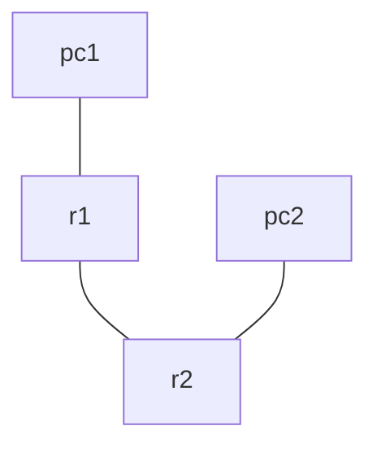

# Netmiko automation on Containerlab

A first automation lab: Containerlab deploys two Cisco IOL routers and two Alpine hosts, and a Netmiko script configures interfaces and eBGP between the routers.

## Scenario



| Device | Interface | Address |
| :--- | :--- | :--- |
| r1 | Ethernet0/1 (to pc1) | 192.168.1.1/24 |
| r1 | Ethernet0/2 (to r2) | 10.0.12.1/30 |
| r2 | Ethernet0/1 (to pc2) | 192.168.2.1/24 |
| r2 | Ethernet0/2 (to r1) | 10.0.12.2/30 |

eBGP between r1 (AS 65001) and r2 (AS 65002), each advertising its LAN prefix.

## Action

### 1. Topology

[simple.clab.yml](simple.clab.yml):

```yaml
name: simple

topology:
  nodes:
    r1:
      kind: cisco_iol
      image: vrnetlab/cisco_iol:17.18.2
    r2:
      kind: cisco_iol
      image: vrnetlab/cisco_iol:17.18.2
    pc1:
      kind: linux
      image: alpine:latest
    pc2:
      kind: linux
      image: alpine:latest
  links:
    - endpoints: ["pc1:eth1","r1:Ethernet0/1"]
    - endpoints: ["pc2:eth1","r2:Ethernet0/1"]
    - endpoints: ["r1:Ethernet0/2","r2:Ethernet0/2"]
```

The management interface of an IOL router is Ethernet0/0. For an L2 IOL switch, add `type: l2` and use the `L2-` image.

### 2. Python script

[script.py](script.py) holds a dictionary of `management IP -> list of configuration commands`. For each router it:

1. retries `ConnectHandler` up to 20 times, 15 seconds apart, because the routers take a while to boot;
2. sends the commands with `send_config_set`;
3. waits 10 seconds for the BGP session to come up, then prints `show ip bgp summary`.

The management IPs in the script (`172.20.20.4` and `172.20.20.5`) are assigned by Containerlab at deploy time. This lab does not pin them, so check them with `containerlab inspect -t simple.clab.yml` and update the script if they differ.

### 3. Deploy, run, tear down

```bash
sudo containerlab deploy -t simple.clab.yml

source ../venv/bin/activate        # or any venv with: pip install -r ../requirements.txt
python3 script.py

ssh admin@clab-simple-r1           # log in to a router (default lab credentials: admin / admin)

sudo containerlab destroy -t simple.clab.yml --cleanup
```

## Result

1. One YAML file deploys and destroys the whole topology.
2. The script has to target the correct management IP of each node, and has to wait until the node has finished booting.
3. Configuration is pushed as a list of commands, so the same pattern scales to more devices by adding entries to the dictionary.
